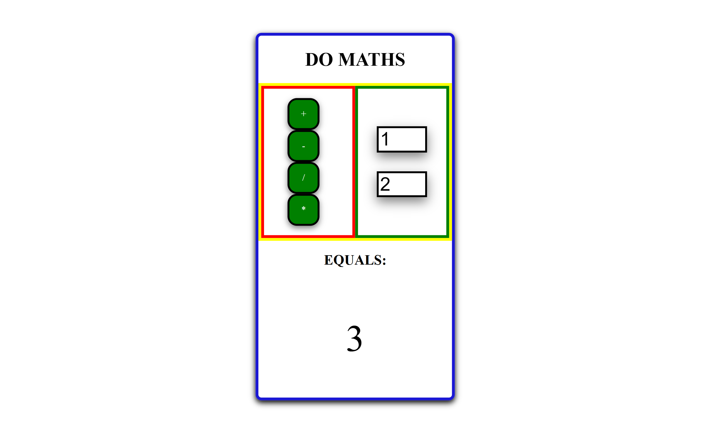

# ➗ Project: Simple Calculator

## Project Description

A very simple calculator web app. Inputs for 2 numerical values. 4 Operands (Add, Subtract, Multiply, Divide). Answers show under EQUALS. 

## Tech Stack

- **HTML** 
- **CSS**
- **JavaScript**

## How to Run or View It

1. Clone or download the repository.
2. Open `index.html` in a browser or serve the project using a local development server.
3. Input 2 values
4. Click the operand of your choosing
5. Simple Calc will display the answer after the EQUALS

## Screenshots and Demo

### Application Interface

The interface displays 2 inputs for numerical values, 4 operands, space for the anser to show. 